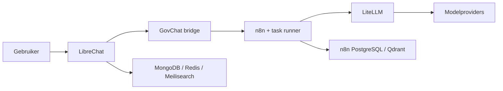

# Infrastructuur

## Deployment opties

De canonical stack wordt als Docker Compose-project beheerd. Dezelfde Compose-configuratie kan draaien op een organisatiebeheerde Linux-host, VM of geschikte containeromgeving; netwerk-, identity- en storage-integratie blijven omgevingsspecifiek.

| Aspect | Referentie-inrichting |
|-------|-------------------------|
| **Installatie** | Docker Engine en Compose plugin |
| **Hosting** | Linux VM of organisatiebeheerde infrastructuur |
| **State** | Persistente Compose volumes/host directories met eigen backupbeleid |

:::tip
Voor productie-omgevingen raden we **Docker** aan. Dit vereenvoudigt installatie, updates en beheer. Zie de [Deployment handleidingen](../handleidingen/deployment/overzicht) voor stapsgewijze instructies.
:::

## Docker Stack

De standaard GovChat-NL stack bestaat uit verschillende containers:

| Container | Image | Functie |
|-----------|-------|---------|
| **librechat** | LibreChat image | Standaard web-interface |
| **librechat-proxy** | Nginx | Overlay-injectie/proxylaag |
| **n8n-openai-bridge** | Lokale GovChat bridge build | OpenAI-compatibele chat- en tool-eventkoppeling |
| **n8n + n8n-runners** | n8n image en JavaScript runner | Workflows en agents |
| **litellm** | LiteLLM image | Modelgateway |
| **mongodb / redis / meilisearch** | Officiële service-images | LibreChat state, sessies/cache en zoekindex |
| **postgres / qdrant** | Database/vector images | n8n/LiteLLM data en interne OpenBesluitvorming-vectoren |

## Authenticatie

GovChat-NL ondersteunt meerdere authenticatiemethoden:

- **Microsoft Entra ID** — de referentieconfiguratie gebruikt OIDC/Entra; callback, app roles en Graph permissions moeten per tenant worden ingesteld
- **LibreChat loginopties** — bepaal lokale/social login en registratiebeleid expliciet via de stackconfiguratie

## Netwerk en beveiliging

- LibreChat gebruikt intern poort **3080**; publicatie/hostpoort volgt `LC_PORT` en de reverse proxy
- De bridge, databases, n8n-beheerinterface en LiteLLM horen intern te blijven tenzij een expliciete beheerroute is beveiligd
- Alle communicatie met LLM-providers verloopt via HTTPS
- Database is alleen intern bereikbaar

## Deployment handleidingen

Stapsgewijze handleidingen per infrastructuur-type:

- [Deployment Overzicht](../handleidingen/deployment/overzicht) — Referentie compose-bestanden en gemeenschappelijke stappen
- [Azure VM](../handleidingen/deployment/azure-vm) — historisch OpenWebUI-voorbeeld, niet de actuele Compose-installatie
- [AWS EC2](../handleidingen/deployment/aws-ec2) — historisch deploymentvoorbeeld
- [Generieke VM](../handleidingen/deployment/generieke-vm) — historische deploymentnotities

## Voorbeeldimplementaties

Zie de sectie [Implementaties](../implementaties/provincie-limburg) voor concrete voorbeelden:

- [Provincie Limburg (LAICA)](../implementaties/provincie-limburg) — Docker op Hetzner/Elestio met Azure OpenAI
- [Gemeente Meierijstad (GAIMS)](../implementaties/gemeente-meierijstad) — Docker met Azure OpenAI
- [Gemeente Nijmegen](../implementaties/gemeente-nijmegen) — Container Services op AWS met AWS LLM Modellen
