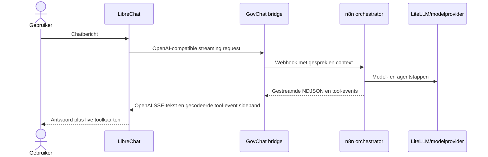

# LibreChat-architectuur

LibreChat is de standaard GovChat-NL-front-end. De referentie-deployment staat in [`docker-compose.yml`](https://github.com/GovChat-NL/GovChat-NL/blob/main/docker-compose.yml) en wordt als geheel gestart. Dit is een referentie-implementatie; iedere organisatie blijft verantwoordelijk voor eigen security-, privacy-, continuïteits- en acceptatiebeoordelingen.

## Componenten

| Laag | Componenten | Rol |
| --- | --- | --- |
| Gebruikersinterface | LibreChat, LibreChat-proxy, admin panel | Chatinterface, login/UI-configuratie en overlay-injectie. |
| Chat- en agentkoppeling | `n8n-openai-bridge` | OpenAI-compatibele `/v1`-endpoint; routeert chatverzoeken naar n8n en streamt tekst en tool-events terug. |
| Workflow runtime | n8n, JavaScript task runner, `n8n-bootstrap` | Draait agent- en app-workflows; bootstrap importeert workflows uit de repository. |
| Model gateway | LiteLLM en PostgreSQL | Modelrouter/provideradapter voor LibreChat en de AI-nodes in n8n. |
| Applicatiedata | MongoDB, Redis, Meilisearch | LibreChat-gesprekken/configuratie, sessie/cache en zoekindex. |
| Workflowdata | PostgreSQL voor n8n, Qdrant | n8n-credentials/executies; Qdrant is intern voor OpenBesluitvorming. |
| Beheer | retention worker, permissions-init, optionele admin-overlay | Databewaring, volume-rechten en optionele beheerfuncties. |

Compose-profielen schakelen aanvullende services in, waaronder RAG (`rag`), beheer (`admin`) en admin-overlay (`admin-overlay`). Controleer de actuele Compose-definities voordat je profielen in een productieomgeving activeert.

## Standaard request-flow

LibreChat gebruikt het custom endpoint `govchat-orchestrator` op `http://n8n-openai-bridge:3333/v1`. De bridge koppelt het modelalias aan de interne n8n-webhook voor de orchestrator. n8n roept LiteLLM/provider-modellen aan. Wijs de orchestrator niet terug naar de bridge: dat veroorzaakt een recursieve bridge→orchestrator→bridge-aanroep.

## Automatische workflow-import

De eenmalige `n8n-bootstrap`-service importeert workflow-JSON uit `agents/n8n/workflows/` in de lokale n8n-database. De normale installatie vereist dus geen handmatige workflow-import. Controleer na de eerste start de bootstraplogs en valideer de bronbestanden met `node tests/agents/validate-workflows.js`.

Importeren configureert geen omgevingsafhankelijke credentials, provider/API-sleutels, webhook tokens of externe databronnen. Controleer die instellingen afzonderlijk en activeer data-ingest/synchronisatieworkflows pas nadat hun bronnen en doelen zijn ingericht.

## Data- en netwerkgrenzen

Services communiceren op interne Docker-netwerken. Publiceer alleen de poorten die voor operators of gebruikers nodig zijn; plaats LibreChat achter de organisatieproxy. MongoDB, n8n/PostgreSQL, Redis, LiteLLM/PostgreSQL en Qdrant bevatten of verwerken gegevens. Beperk beheerpoorten en toegangsrechten en test herstel uit back-ups. De retentie-worker en n8n execution/log cleanup zijn configureerbaar; zie het [retentiebeleid in de hoofdrepository](https://github.com/GovChat-NL/GovChat-NL/blob/main/docs/retention-policy.md).

## Verder lezen

- [Snelle start en deployment](../handleidingen/librechat-pre-release)
- [Omgevingsvariabelen](../handleidingen/librechat-omgevingsvariabelen)
- [Live tool-calling](./live-tool-calling)
- [n8n bridge-broncode](https://github.com/GovChat-NL/n8n-openai-bridge)
- [GovChat-NL hoofdrepository](https://github.com/GovChat-NL/GovChat-NL)

