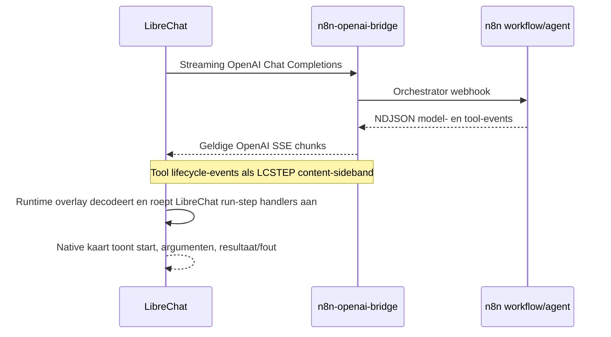

# Live tool-calling via n8n

GovChat-NL toont tools die de n8n-agent aanroept direct in de LibreChat-chat als native toolkaarten. Gebruikers zien dat een tool start, welke stap draait en wat het resultaat of de fout is; de uiteindelijke assistenttekst blijft gewone chatinhoud.

## Event-flow

De OpenAI-compatibele stream-parser van LibreChat accepteert `data:`-frames met Chat Completions chunks, maar geeft willekeurige benoemde SSE-events niet door. Daarom codeert de bridge toegestane LibreChat `on_run_step*` lifecycle-payloads in een afgeschermde `LCSTEP:`-content-marker. De LibreChat runtime-overlay decodeert de marker incrementeel, geeft het event door aan LibreChat's eigen run-step handlers en verwijdert de marker uit zichtbare assistanttekst. Gewone tekst voor en na markers blijft op volgorde behouden.

## Benodigde onderdelen

- De bridge uit [GovChat-NL/n8n-openai-bridge](https://github.com/GovChat-NL/n8n-openai-bridge), met eventproductie en sideband-encoding in geldige OpenAI streaming chunks.
- LibreChat-runtime overlays en preload, read-only gemount vanuit `scripts/` en geladen vóór de serverstart.
- De n8n event-stream patch die echte tool-end- en tool-error-events doorgeeft.
- Een n8n-agentworkflow met tool nodes. Model/providerkeuze blijft in LiteLLM; configureer het orchestrator-model niet om de bridge aan te roepen.

De standaard [`docker-compose.yml`](https://github.com/GovChat-NL/GovChat-NL/blob/main/docker-compose.yml) bouwt de bridge uit de sibling-checkout `../n8n-openai-bridge-main` op branch `main`; er is geen feature-branch override nodig. De bridgecheckout moet naast de GovChat-NL-checkout staan. Na wijzigingen aan bridgebron moet de bridge-image expliciet worden herbouwd.

## Verificatie

1. Controleer de Compose-configuratie en of de bridge health-endpoint en `/v1/models` reageren.
2. Controleer de startup logs van de LibreChat runtime-overlay, bridge en n8n.
3. Voer een chat uit die minimaal één echte tool gebruikt.
4. Bevestig dat de kaart direct start, invoer en resultaat toont, fouten als foutstatus weergeeft en geen `LCSTEP`-marker in de assistenttekst lekt.
5. Controleer dat meerdere toolstappen op volgorde staan en de uiteindelijke assistentrespons behouden blijft.

De hoofdrepository bevat de diepere [ontwerpnotitie, compatibility-beperkingen, tests en deploymentstappen](https://github.com/GovChat-NL/GovChat-NL/blob/main/docs/live-tool-calling.md). Een werkende bridge-stream alleen is niet voldoende: ook de LibreChat-overlay en n8n patches zijn noodzakelijk voor native kaarten.
