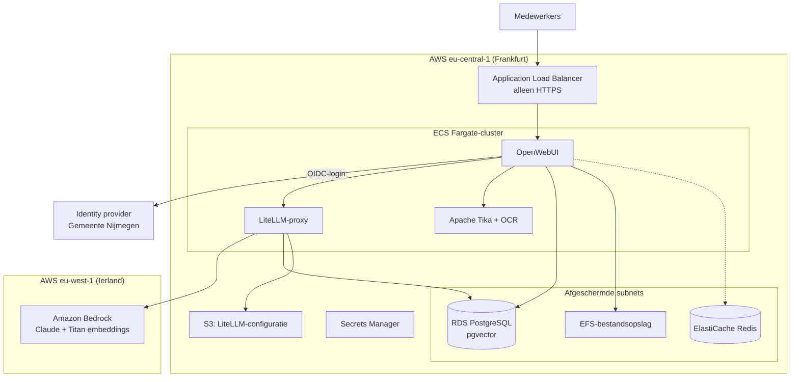

# Gemeente Nijmegen (Nimmai)

Gemeente Nijmegen draait haar interne AI-chatomgeving onder de naam **Nimmai**. In tegenstelling tot de andere implementaties gebruikt Nijmegen geen Azure OpenAI, maar **Amazon Bedrock** met de Claude-modellen van Anthropic, en draait de hele omgeving als managed containers in **AWS** (eu-central-1, Frankfurt). De infrastructuur is volledig als code beschreven met AWS CDK en wordt via een pipeline uitgerold naar een ontwikkel-, acceptatie- en productieomgeving. Deze pagina beschrijft hoe de omgeving is opgebouwd en welke keuzes daarbij zijn gemaakt.

## In één oogopslag

| Component | Keuze |
|-----------|-------|
| Taalmodellen | Amazon Bedrock (Claude Sonnet, Claude Haiku, Titan embeddings) via LiteLLM |
| Authenticatie | OIDC-koppeling met de identity provider van de gemeente |
| Interface | OpenWebUI |
| Deployment | AWS ECS Fargate, infrastructuur als code (AWS CDK, TypeScript) |
| Data | RDS PostgreSQL met pgvector, EFS voor bestanden, ElastiCache Redis |
| Hosting | AWS eu-central-1 (Frankfurt); modellen in eu-west-1 (Ierland) |
| Omgevingen | Ontwikkel, acceptatie en productie, elk in een eigen AWS-account |

## Architectuur

Alle onderdelen draaien als losse services in één ECS Fargate-cluster, binnen het VPC van de Nijmeegse AWS-landingzone. Gebruikers komen binnen via een Application Load Balancer; de services praten onderling via een interne DNS-naamruimte (`*.internal`). Databases, cache en bestandsopslag staan in afgeschermde subnets zonder internettoegang.

### Services

| Service | Image | Functie |
|---------|-------|---------|
| OpenWebUI | `ghcr.io/open-webui/open-webui` | Webinterface en backend, 2 taken in productie |
| LiteLLM | `ghcr.io/berriai/litellm` | OpenAI-compatibele proxy naar Amazon Bedrock |
| Tika | Eigen image op basis van Apache Tika | Documentverwerking, met Tesseract OCR (standaard Nederlands) |

Versies van de images worden per omgeving vastgepind. Een update gaat daardoor eerst naar ontwikkel en acceptatie, en pas daarna naar productie.

### Opslag en data

| Onderdeel | Dienst | Functie |
|-----------|--------|---------|
| Database | RDS PostgreSQL (Multi-AZ in acceptatie en productie) | Gedeelde database-instance met aparte databases voor OpenWebUI en LiteLLM; `pgvector` voor RAG |
| Cache | ElastiCache Redis | WebSocket-verkeer en configuratiesynchronisatie tussen meerdere OpenWebUI-taken |
| Bestanden | EFS (versleuteld) | Uploads en overige lokale data van OpenWebUI |
| Configuratie | S3 (met versiebeheer) | LiteLLM-configuratie, per omgeving gegenereerd |

Omdat OpenWebUI in acceptatie en productie met twee taken draait, is Redis daar verplicht. De code weigert zelfs uit te rollen als er meer dan één taak is ingesteld zonder Redis, zodat die combinatie niet per ongeluk in productie terechtkomt.

## Taalmodellen via Amazon Bedrock

LiteLLM vertaalt de OpenAI-compatibele aanroepen van OpenWebUI naar Amazon Bedrock. Nijmegen gebruikt de **EU cross-region inference profiles** van Bedrock, zodat aanvragen binnen de EU worden verwerkt.

| Model | Gebruik |
|-------|---------|
| Claude Sonnet 4.6 | Standaardmodel voor chat |
| Claude Haiku 4.5 | Sneller en goedkoper model voor eenvoudige taken |
| Amazon Titan Text Embeddings v2 | Embeddings voor documentzoekopdrachten (RAG) |

Een paar keuzes die het vermelden waard zijn:

- **Prompt caching.** Voor Claude Sonnet is prompt caching van de systeemprompt en tot het laatste gebruikersbericht ingeschakeld. Dat scheelt kosten en tijd bij lange gesprekken.
- **Geen statische API-sleutels.** LiteLLM benadert Bedrock met de IAM-rol van de container. Er staan geen AWS-sleutels in de configuratie.
- **Gebruikers herkennen in LiteLLM.** OpenWebUI stuurt het gebruikers-ID mee naar LiteLLM. Daardoor kan LiteLLM gebruik en kosten per gebruiker bijhouden en zo nodig limieten per gebruiker afdwingen.

### Limieten per gebruiker

Via de budgetfunctie van LiteLLM kan per gebruiker een limiet worden ingesteld: een maximum aantal tokens per minuut en een wekelijks kostenplafond. Voor intensieve gebruikers kan een aparte 'tier' worden aangemaakt met ruimere limieten. Daarnaast geldt een limiet op teamniveau als vangnet. Deze functionaliteit wordt momenteel op de ontwikkelomgeving beproefd.

## Authenticatie

Medewerkers loggen in via **OIDC** bij de identity provider van de gemeente. Inloggen met het standaard beheerdersaccount is uitgeschakeld. De OIDC-gegevens staan in AWS Secrets Manager.

## Beveiliging

**Netwerk.** Alleen de load balancer is vanaf internet bereikbaar, en uitsluitend via HTTPS. Database, Redis en EFS accepteren alleen verkeer van de ECS-taken. LiteLLM accepteert intern alleen verkeer van OpenWebUI en de monitoring-functies; Tika is helemaal niet van buitenaf bereikbaar.

**Secrets.** Databasewachtwoorden, OIDC-gegevens en de LiteLLM-sleutel staan in AWS Secrets Manager. De databasewachtwoorden worden bij de eerste uitrol automatisch gegenereerd.

**Versleuteling.** De database en de bestandsopslag zijn versleuteld at rest. Van de database worden 7 dagen snapshots bewaard.

## Monitoring en beheer

Alle alarmen zijn in code vastgelegd en komen bij het beheerteam binnen. Alarmen die gebruikers direct raken, gaan in productie ook per e-mail naar de eerstelijns support. Voorbeelden:

- Geen gezonde OpenWebUI- of LiteLLM-instanties
- Te veel foutmeldingen (5xx) op de load balancer
- Bedrock die aanvragen afknijpt (throttling) of tijdelijk niet beschikbaar is
- Uitgaven boven een ingestelde drempel per 24 uur
- Hoog CPU- of geheugengebruik, of een bijna volle database-verbindingspool

Een functie haalt elk uur geaggregeerde gebruikscijfers uit LiteLLM op (aantal aanvragen, tokens, kosten per model, aantal actieve gebruikers) en zet die op een dashboard voor support. Dat dashboard bevat bewust geen gegevens per persoon. De functie gebruikt een alleen-lezen sleutel, nooit de master key van LiteLLM.

## Kosten beperken

- **Kantooruren voor test-omgevingen.** De ontwikkel- en acceptatieomgeving worden buiten kantooruren automatisch naar nul containers geschaald en 's ochtends weer opgestart.
- **Kleiner op ontwikkel.** De ontwikkelomgeving draait met één OpenWebUI-taak, zonder Redis en met een kleinere database.
- **Bedrock betaal je per gebruik.** Er is geen vaste capaciteit gereserveerd; kosten ontstaan alleen bij daadwerkelijk gebruik, en worden bewaakt met de uitgavenalarmen.

## Geleerde lessen

- **Infrastructuur als code loont.** Alle omgevingen zijn identiek opgebouwd en verschillen alleen in een paar instellingen. Wijzigingen gaan via een pull request en een pipeline, niet via handwerk in een console.
- **Meer dan één OpenWebUI-instantie vraagt om Redis.** Zonder Redis lopen WebSocket-verbindingen en instellingen tussen instanties uit de pas.
- **Let op fouten die de load balancer niet ziet.** Bij streaming-antwoorden is de HTTP-status al verstuurd voordat een fout van Bedrock optreedt. Zulke fouten zijn alleen in de logs van LiteLLM te zien; We tellen ze daarom apart en alarmeren daarop.
